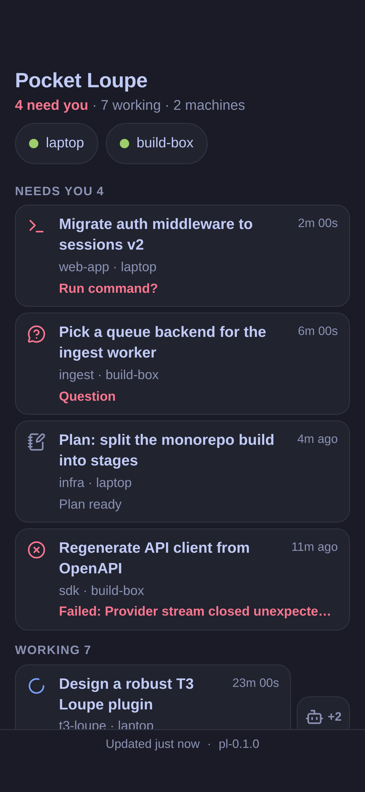
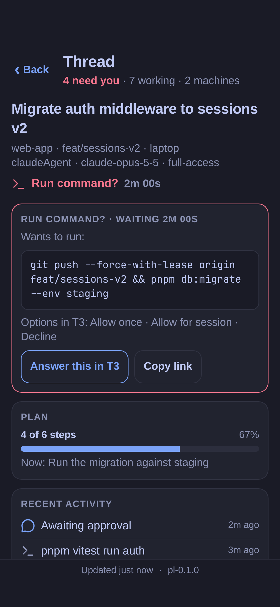

# T3 Pocket Loupe

T3 Loupe on your iPhone: a read-only, tailnet-only home-screen web app for [T3 Code](https://github.com/pingdotgg/t3code) agents.

 

*Screenshots use synthetic demo data.*

## What it is

[T3 Loupe](https://github.com/AmbitiousRealism2025/t3-loupe) shows what every T3 Code thread is doing, across every paired machine, in the Omarchy bar. Pocket Loupe puts the same overview on your phone:

- **Needs you, Working, Done**, in the same order and grouping as T3 Loupe's panel, across every machine.
- **Thread detail on tap:** the exact command waiting for approval or the question and its options, plan progress, recent activity, runs, context and cost, the pull request, and subagents.
- **Machine health and usage:** a dot per machine, and each provider's usage windows with reset times.
- **Honest when offline:** the last state stays on screen with its age and "host unreachable".
- **Read-only.** It shows; it never acts. "Answer this in T3" opens T3's own web UI on the same machine.
- **Tailnet only.** It's served with `tailscale serve`, so only devices on your Tailscale network reach it. No cloud, no public URL, no login, no T3 Connect.

## How it works

```
 Omarchy machine                                                   iPhone
 ┌───────────────────────────────────────────────────────────┐
 │ T3 Loupe's collector         Pocket Loupe server           │
 │ (daemon/main.ts run)  ─────▶ 127.0.0.1:8443                │
 │  · holds the T3 tokens       · /api/state, /api/thread,    │
 │  · read-only sessions          /api/events, /api/theme     │
 │                              · serves public/              │
 │              tailscale serve --https=8443 ────────────────────▶ home-screen app
 └───────────────────────────────────────────────────────────┘   (tailnet HTTPS)
```

The server starts its own copy of T3 Loupe's collector and reads the same NDJSON stream the Omarchy shell reads. T3 Loupe itself isn't changed, so its verified marketplace listing isn't touched. The cost is a second set of read-only connections to each T3 server.

## Requirements

- An Omarchy machine with the [T3 Loupe plugin](https://plugins.omarchy.org/plugin.html?id=ambitiousrealism.t3-loupe) installed and paired with your T3 machines.
- Node 22.18 or newer (it runs `server.ts` directly; no `npm install`, no dependencies).
- Tailscale with MagicDNS and HTTPS certificates enabled, on the machine and on the phone.
- systemd user services.

## Install

```bash
git clone https://github.com/AmbitiousRealism2025/t3-pocket-loupe ~/coding-projects/t3-pocket-loupe
cd ~/coding-projects/t3-pocket-loupe
npm test                      # optional: the test suite
tools/install-service.sh      # systemd user unit + tailscale serve on port 8443
```

`install-service.sh` refuses to run if port 8443 is taken locally or on the tailnet by something else. It never changes other `tailscale serve` mappings and never uses Funnel or sudo. Undo it with `tools/install-service.sh --uninstall`.

**The app's origin is `https://<your machine>.ts.net:8443/`** (the exact name is in `tailscale status`), and the manifest `id` is `/`. An installed home-screen app is bound to its origin, so choose the machine name and port before installing on a phone. Issuing the HTTPS certificate writes the machine name to public Certificate Transparency logs.

**On the iPhone:** open that URL in Safari, then Share → Add to Home Screen, with "Open as Web App" left on. Keep Tailscale connected on the phone.

To try it without T3, run the demo: `tools/dev.sh 8080` and open `http://127.0.0.1:8080/`.

## Security model

- **The tailnet is the lock.** The server binds `127.0.0.1` only and refuses any other address; `tailscale serve` is the one thing that reaches it. Any device on your tailnet can see the app, so on a shared tailnet add a Tailscale grant for port 8443.
- **Tokens never leave the host.** They stay in T3 Loupe's collector. Every API field is picked by name (`lib/project.ts`); T3 URLs, worktree paths, host labels and anything the collector adds later are dropped. The phone stores nothing it couldn't rebuild.
- **Read-only.** No route changes T3 state. The collector's `copy`, `reload` and `refresh` commands aren't exposed.
- **Guards from the NixWeb Standard:** a Host-header allowlist against DNS rebinding, cross-site write refusal, no CORS, a strict Content-Security-Policy with no inline script, `textContent` only, publish-only static serving with traversal and symlink protection, and request size and time limits.
- **No private text in process arguments.** The collector is spawned with fixed arguments.
- **Full text on a personal tailnet.** Thread titles and command text are shown as they are, because that's the point of the app. This was a deliberate choice for a personal tailnet.

## Development

```bash
npm test                    # node --test: bridge, projection, guards, SSE, Node-only rules, run mode
tools/dev.sh [port]         # demo mode
tools/nixweb-check.sh       # nixweb check --level 2 against a demo server
tools/screenshots.sh        # docs/screens at iPhone size (headless Chrome, demo data)
tools/check-version.sh      # public/ changed → VERSION in public/sw.js must change
tools/privacy-scan.sh       # before every push
tools/vendor-sync.sh        # refresh public/vendor/ from T3 Loupe (see VENDOR.md)
```

See [AGENTS.md](AGENTS.md) for the hard constraints, [CONFORMANCE.md](CONFORMANCE.md) for the NixWeb status, and [docs/PROPOSAL.md](docs/PROPOSAL.md) for the design.

## Related

- **T3 Loupe**, the Omarchy plugin this builds on: https://github.com/AmbitiousRealism2025/t3-loupe
- **nixweb.app** by Fred Nix, the standard and checker this follows: https://github.com/nixfred/nixweb.app. Pocket Loupe uses the NixWeb Standard and `nixweb check`; it copies no code from the nixweb template.
- **T3 Code's own clients** (the mobile app and `app.t3.codes`) can answer approvals. Pocket Loupe is the read-only overview of every machine; when something needs an answer, you open T3.

## License

MIT. See [LICENSE](LICENSE). Vendored T3 Loupe code is MIT and its Lucide icon paths are ISC; see [VENDOR.md](VENDOR.md).
